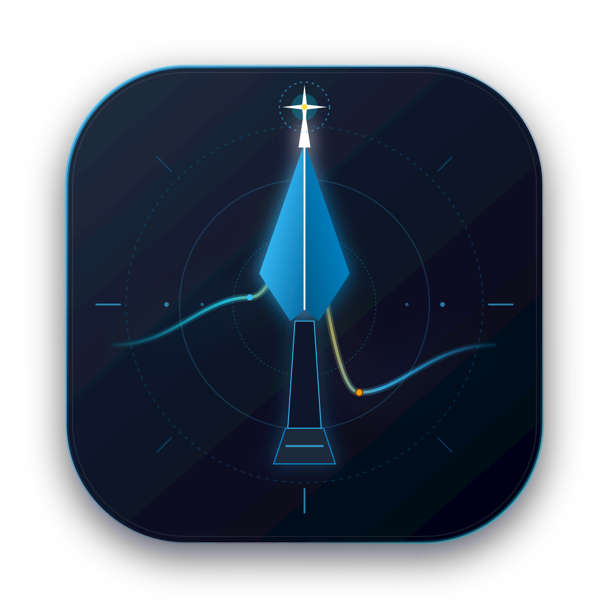
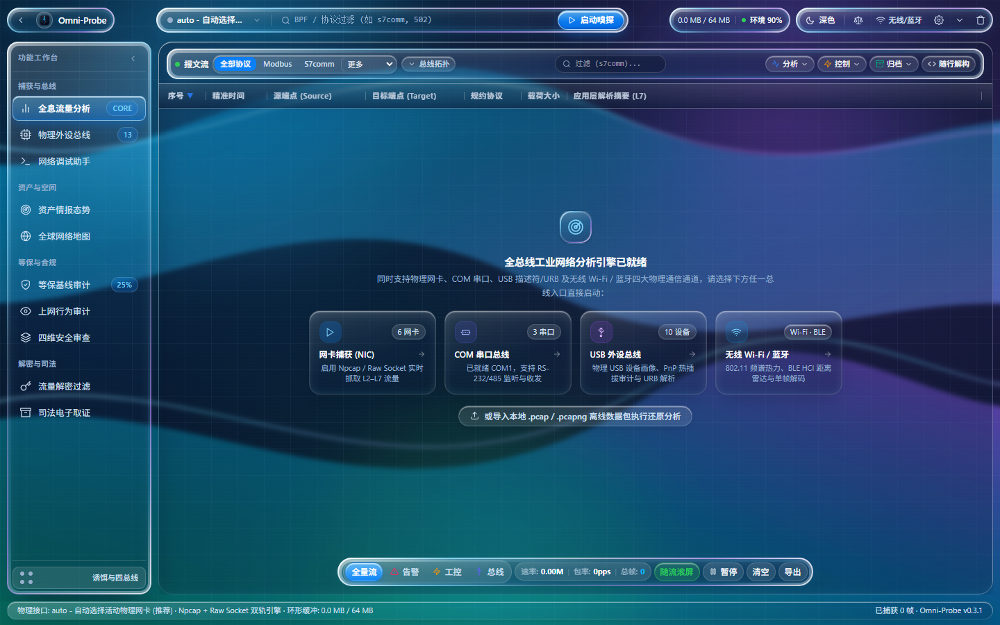
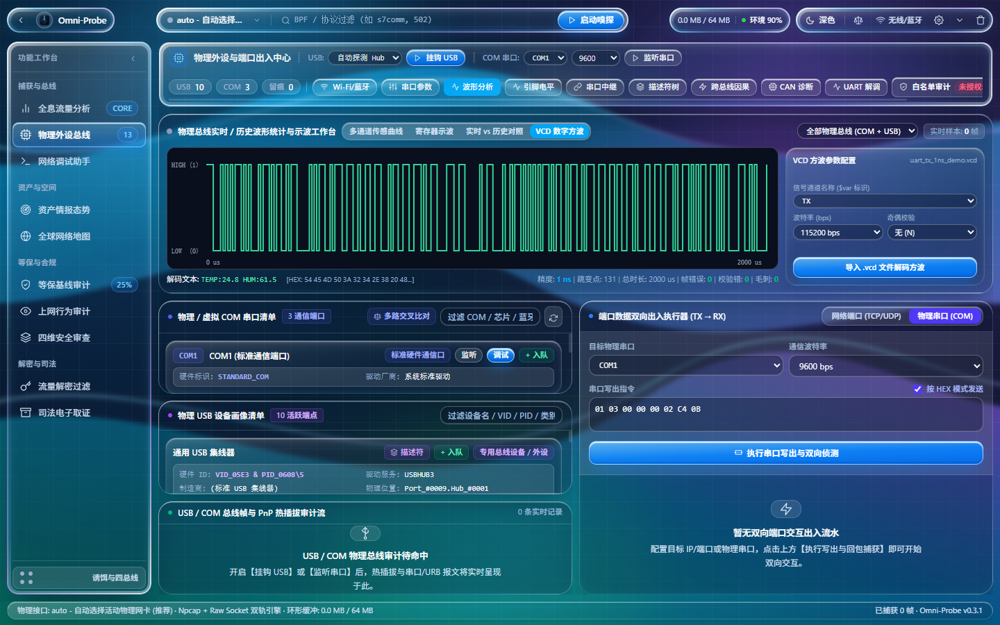
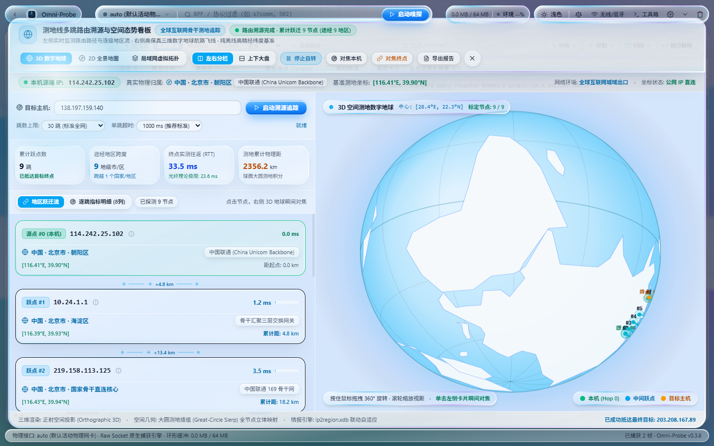
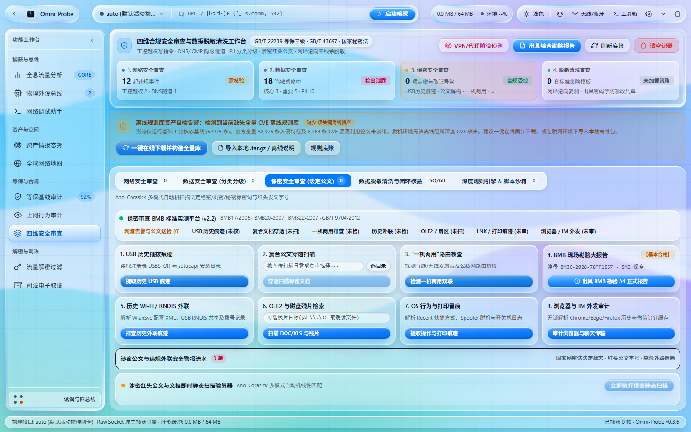

# Omni-Probe: Multi-Bus Network & Hardware Protocol Analyzer (v0.3.8)

<div align="center">



### Industrial-Grade Native Desktop Multi-Bus Network & Fieldbus Deep Analysis Platform
**Built with Rust (Edition 2024) + Tauri 2.0 + Vue 3.5 + TypeScript**

[](https://github.com/daybydaymylove-max/omni-probe-tauri/releases)
[](https://opensource.org/licenses/Apache-2.0)
[](https://www.rust-lang.org/)
[](https://tauri.app/)
[](https://vuejs.org/)
[]()
[]()

<br>

**[English](README.md)** • **[简体中文 (Chinese)](README_zh.md)** • **[📖 User Manual](docs/USER_MANUAL.md)**

<br>

**[ 📥 Download Latest Multi-Platform Packages (v0.3.8) ](https://github.com/daybydaymylove-max/omni-probe-tauri/releases/latest)**  
*🪟 Windows (Portable / Setup / MSI) • 🐧 Linux (DEB / AppImage / RPM) • 🍏 macOS (Apple Silicon DMG)*

<br>

<p align="center">
  
</p>

</div>

---

## 📌 Overview

**Omni-Probe** is an ultra-lightweight, high-performance, native desktop multi-bus network and embedded fieldbus deep analysis platform. It is engineered from the ground up to replace bloated Electron-based tools and obsolete UI stacks, bridging the gap between traditional packet analyzers (Wireshark), hardware logic analyzers (Saleae / PulseView), and compliance audit toolkits.

### Why Omni-Probe?

| Metrics & Resource Overhead | Omni-Probe (Rust + Tauri 2.0) | Traditional Electron Tools | Native Wireshark (Qt) |
| :--- | :---: | :---: | :---: |
| **Setup Package Size (x64)** | **8.59 MB** | 120 MB ~ 180 MB | ~85 MB |
| **Standalone Portable `.exe`** | **31.70 MB** | 150 MB+ | ~100 MB |
| **Cold-Start Resident Memory (RSS)** | **~32 MB - 48 MB** | 240 MB - 380 MB | ~90 MB - 140 MB |
| **Cold Boot Latency** | **< 280 ms** | 1,800 ms - 3,200 ms | ~900 ms |
| **Multi-Bus Fusion** | **Ethernet + USB + Serial + CAN + VCD** | Network Only | Network Only |
| **Memory Safety Guarantee** | **100% Rust Safe Engine** | Node.js Runtime Overhead | Legacy C/C++ Buffer Vulnerabilities |

---

## 🚀 Key Architectural Features

### 1. Multi-Bus Capture & Deep Protocol Analysis
- **Ethernet & Wireless**: High-throughput packet capture via Npcap / AF_PACKET / eBPF bypass with zero packet drop buffer ring.
- **Embedded & Industrial Fieldbuses**: Native support for RS-485 Modbus RTU/ASCII, CAN 2.0A/B & CAN-FD, USB 2.0/3.0 descriptor capture (USBPcap), and Bluetooth BLE advertising snooping.
- **Microcontroller Toolkits**: Embedded struct slicing, VOFA+ `JustFloat` stream decoding, PID step response transient solver, and baud rate error calculation.

<p align="center">
  
</p>

### 2. Declarative Protocol Dissector VM (`dynamic_dissector_vm.rs`)
- Zero re-compilation needed for proprietary or niche SCADA protocols.
- Load custom protocol schemas via JSON/DSL at runtime with support for dynamic endianness, bitfield masks, conditional branching, `FromTail` backwards offset slicing, and hardware-grade CRC-16/Modulo-256 checksum validations.
- Built-in out-of-the-box support for **IEC 60870-5-104** (Power Telecontrol) and **DL/T 645-2007** (Smart Electric Metering).

### 3. Chunked Streaming Sparse Indexer for Multi-GB PCAP (`pcap_sparse_indexer.rs`)
- Solves Out-Of-Memory (OOM) crashes when opening multi-gigabyte PCAP/PCAPng capture files.
- Single-pass scanning builds a 2-level sparse index ($O(N / \text{Stride})$): a 10-million-packet capture generates only 20,000 index nodes (~640 KB memory).
- Sliding-window paged querying guarantees strictly bounded $\mathcal{O}(\text{WindowSize})$ memory consumption (tens of kilobytes), completely decoupled from the file size.

### 4. Virtual Physical Logic Signal Generator & Glitch Injection (`virtual_logic_generator.rs`)
- Pure Rust nanosecond-accuracy waveform synthesizer for UART, I2C, SPI, and CAN 2.0A.
- Strict hardware modeling of CAN bit-stuffing (inserting an opposite polarity bit after 5 identical consecutive bits) and CRC-15.
- Real-time fault injection: transient glitch pulse injection and clock jitter simulation, exporting standard IEEE 1364-2001 VCD files.

### 5. 3D Geodesic Traceroute & Digital Globe
- Spherical Great-Circle Distance and Quaternion Slerp (Spherical Linear Interpolation) trajectory rendering.
- Multi-hop IP geolocation mapping with latency jitter bars, BGP AS attribution, and Bufferbloat queuing analysis.

<p align="center">
  
</p>

### 6. Regulatory Compliance & Forensic Audit Reports
- **GB/T 22239-2019 (MLPS 2.0)**: Standard formal on-site assessment engine covering physical, network, boundary, computing, and management domains, with A4 vector printable reports.
- **BMB Secrecy Audit & 8 Forensic Engines**: USB hardware serial whitelist auditing, cross-network dual-homed violation detection, OLE2 CFBF deleted document slack space mining, and privilege separation verification.
- **Tamper-Proof Evidence**: Output dual cryptographic hashes (National Commercial Cryptography SM3 + SHA-256) and TLSH locality-sensitive hash clustering.

<p align="center">
  
</p>

---

## 🛠️ Quick Start & Build Instructions

### Prerequisites
- [Node.js](https://nodejs.org/) (v18+ or v20+)
- [Rust](https://www.rust-lang.org/) (v1.80+ / Edition 2024 recommended)
- [Tauri CLI](https://tauri.app/start/) (v2.0)

### Installation & Development
```bash
# 1. Clone the repository
git clone https://github.com/daybydaymylove-max/omni-probe-tauri.git
cd omni-probe-tauri

# 2. Install frontend dependencies
npm install

# 3. Launch live development mode with hot-reload
npm run tauri dev
```

### Production Release Build
```bash
# Run full unit tests & build release bundles (.exe, .msi, NSIS setup)
npm run test
cargo test --manifest-path src-tauri/Cargo.toml --lib
npx tauri build
```
Production output files will be located in:
- Portable executable: `src-tauri/target/release/omni-probe-tauri.exe`
- NSIS Setup: `src-tauri/target/release/bundle/nsis/omni-probe-tauri_0.3.8_x64-setup.exe`
- WiX MSI: `src-tauri/target/release/bundle/msi/omni-probe-tauri_0.3.8_x64_en-US.msi`

---

## 📄 License & Integrity

This project is licensed under the **Apache-2.0 License**. See the [LICENSE](LICENSE) file for details.  
All code implementations follow zero-placeholder production guidelines and strict memory safety.
