# Omni-Probe 软件操作手册（完整图文版）

> **适用软件版本**：`v0.3.2`  
> **文档定位**：面向一线运维人员、网络工程师、嵌入式单片机调试人员及安全审计人员的实用操作指南（全部界面截图均采集自程序实机运行状态，并随软件功能迭代同步更新维护）。

---

## 快速导航：我今天想做什么？

* **想抓电脑网卡上的网络流量、查断网或慢响应** → 直接看 [第 2 章：网络抓包与流量分析](#2-网络抓包与流量分析全息流量分析)
* **接了单片机 / 开发板 / PLC 串口，想发指令、看数据并画实时波形图** → 直接看 [第 3 章：单片机串口、波形图与硬件总线调试](#3-单片机串口波形图与硬件总线调试物理外设总线)
* **想抓 USB 外设（键盘、U 盘、调试器）数据或看设备硬件信息** → 直接看 [3.3 节：USB 外设监测与硬件描述符查看](#33-usb-外设监测与硬件描述符查看)
* **想搜索周边 Wi-Fi 热点信号强弱、扫描蓝牙设备并测距离** → 直接看 [第 4 章：Wi-Fi 频谱与蓝牙近场扫描](#4-wi-fi-频谱与蓝牙近场扫描无线蓝牙)
* **想建个临时 TCP/UDP 工具测试设备通不通，或查局域网有哪些机器** → 直接看 [第 5 章：网络发包调试与全网设备扫描](#5-网络发包调试与全网设备扫描)
* **想查看网络合规检查、解密 HTTPS、或者留存防篡改取证报告** → 直接看 [第 6 章：安全审计、流量解密与取证导出](#6-安全审计流量解密与取证导出)
* **想对比两次抓包结果、多条串口数据或两个本地大文件哪里不一样** → 直接看 [第 7 章：报文与文件差异对比中心](#7-报文与文件差异对比中心)
* **抓不到包、串口没反应、Wi-Fi 提示不可用怎么办** → 直接看 [第 9 章：常见问题现场自助排查](#9-常见问题现场自助排查)

---

## 1. 初次使用与界面布局认识

### 1.1 启动软件
* **安装版**：运行 `.msi` 或 `-setup.exe` 安装包完成向导安装后，从桌面或开始菜单打开 **Omni-Probe**。
* **绿色便携版**：直接双击 `omni-probe-tauri.exe` 即可打开（所有数据与日志默认自动存放在程序专属数据目录，免配置开箱即用）。
* **权限建议**：普通双击启动即可查看界面、用串口调试、扫蓝牙与做离线文件分析；如果需要抓取 USB 总线底层数据包或拦截全部网卡底层帧，建议关闭软件后 **右键软件图标 → 以管理员身份运行**。

### 1.2 主界面三大区域一览

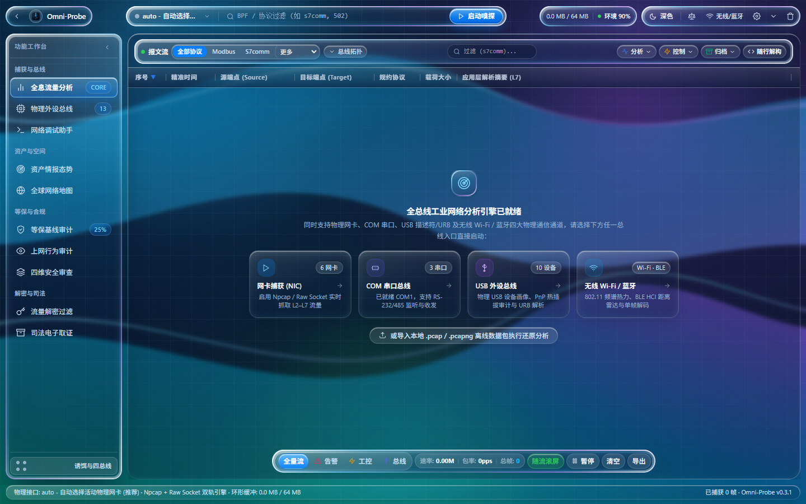

打开软件后，主窗口自上而下、从左到右分为三部分：
1. **顶部悬浮控制条**：
   * **最左侧**：导航栏展开/折叠按钮（当检测到异常安全告警时，旁边还会出现红色应急切断开关）。
   * **正中间**：选网卡下拉框（默认 `auto - 自动选择活动物理网卡 (推荐)`，Windows 下内置无 `Npcap` 替代选项 **`native-ndis - Windows 内置 NDIS-ETW 免驱 L2 引擎`**）+ 搜索/过滤输入栏 + **`启动嗅探`** 按钮（启动后会变为 **`暂停`** 和停止按钮）。
   * **最右侧**（从左到右依次为）：
     * **`环境 XX%`** 状态胶囊：显示当前驱动准备情况与内存占用，点一下可在正下方展开轻量检查小窗口；
     * **深色 / 浅色切换**：切换深空夜色或冰晶白昼外观；
     * **天平图标（全局比对）**：把散落在各处收集到的样本集中对比（快捷打开：`Ctrl + Shift + D`）；
     * **`无线/蓝牙`**：打开 Wi-Fi、蓝牙与 VLAN 监测控制台；
     * **齿轮图标（设置）**：打开系统偏好设置中心（快捷打开：`Ctrl + ,`）；
     * **向下箭头**：把软件缩小隐藏到电脑右下角系统托盘后台驻留；
     * **垃圾桶图标**：清空当前屏幕攒下的抓包缓存。
2. **左侧主工作台切换栏**（四大分域共 10 个核心工作区）：
   * **捕获与总线**：`全息流量分析`、`物理外设总线`、`网络调试助手`
   * **资产与空间**：`资产情报态势`、`全球网络地图`
   * **等保与合规**：`等保基线审计`、`上网行为审计`、`四维安全审查`
   * **解密与司法**：`流量解密过滤`、`司法电子取证`
3. **中央工作主区**：随左侧所选工作台自动切换显示内容；初始页面即提供 **网卡捕获 (NIC)**、**COM 串口总线**、**USB 外设总线**、**无线 Wi-Fi / 蓝牙** 4 张入口卡片以及离线 `.pcap` 导入按钮。

### 1.3 使用「环境检查器」（顶部 `环境 XX%`）
Omni-Probe 开机即走内置保底引擎无需强卡弹窗。想确认全量扩展驱动是否齐备，只需点击右上角的 **`环境 XX%`** 状态胶囊：

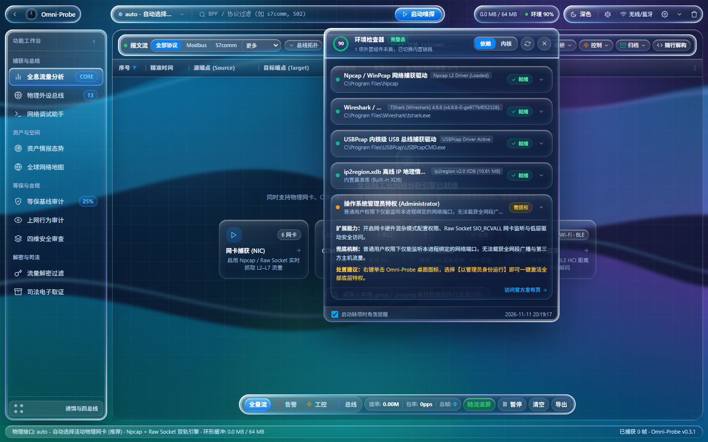

* **「依赖」页**：清晰列出 **Npcap / WinPcap 网络捕获驱动**、**Wireshark / TShark 协议解剥引擎**、**USBPcap 内核级 USB 总线捕获驱动**、**ip2region.xdb 离线 IP 地理库** 和 **操作系统管理员特权** 5 项状态：
  * **绿点（就绪）**：已安装好，全功能生效。
  * **黄点（需补齐或正用替代方案）**：软件核心功能仍照常可用；点任意一行的折叠箭头可查看详细原因及 **`访问官方发布页 →`** 跳转，部分缺项还会直接提供 **`安装`** / **`下载库`** 一键按钮（关闭小窗口后下载也会在后台继续完成）。
* **「内核」页**：切换到顶部 **`内核`** 按钮，可实时查看锁页零拷贝缓冲池占用率、大象流直通比例，以及一键开关过滤策略（未切进这一页时不占用多余刷新资源）。

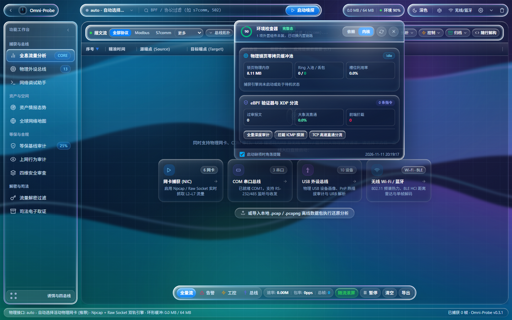

* **角落提醒开关**：勾选左下 **`启动缺项时角落提醒`**，如果检测到可升级的驱动缺项会在启动时于角落温和通知；不想被打扰取消勾选即可。

---

## 2. 网络抓包与流量分析（`全息流量分析`）

> **进入方式**：左侧导航栏 **捕获与总线 → `全息流量分析`**（打开软件默认即处于此页面）

### 2.1 三步开始抓取电脑网络通信
1. **选网卡**：点顶部搜索框左边的网卡下拉列表（默认 `auto` 自动选正在上网的物理网卡；若要只测本地软件对 `8080`/`502`/`1883` 的测试发包，可选择 `dual-track - 双轨应用层多端口监听服务`）。
2. **开始抓**：点 **`启动嗅探`**，中间表格立刻开始实时滚动展示进出的数据包（显示序号、精准时间、源端点、目标端点、规约协议、载荷大小与 L7 应用层摘要）。
3. **暂停细看**：流量滚太快看不过来时，按一下键盘 **`空格键`**（或点 **`暂停`**），画面立即定格；再次按空格继续。

### 2.2 快速找到想要的包
* **顶部输入过滤词**：按 `Ctrl + K` 快速定位到顶部输入框，输入 `192.168.1.50`、端口 `502` 或协议 `modbus`、`http` 回车筛选。
* **一秒切换四大视角**（底部居中悬浮胶囊栏或按单键）：
  * 点 **`全量流`**（按 `0`）：查看全部流量；
  * 点 **`告警`**（按 `A`）：只筛选告警或高熵异常报文；
  * 点 **`工控`**（按 `I`）：只过滤 Modbus、S7comm、IEC 104 等工控与物联网规约；
  * 点 **`总线`**（按 `B`）：只看串口、USB 与无线接入的数据帧。
* **协议快捷标签**：点表格上方快捷药丸按钮（如 `全部协议`、`Modbus`、`S7comm` 等）一键筛选。

### 2.3 查看单条报文内容与右侧随行解构

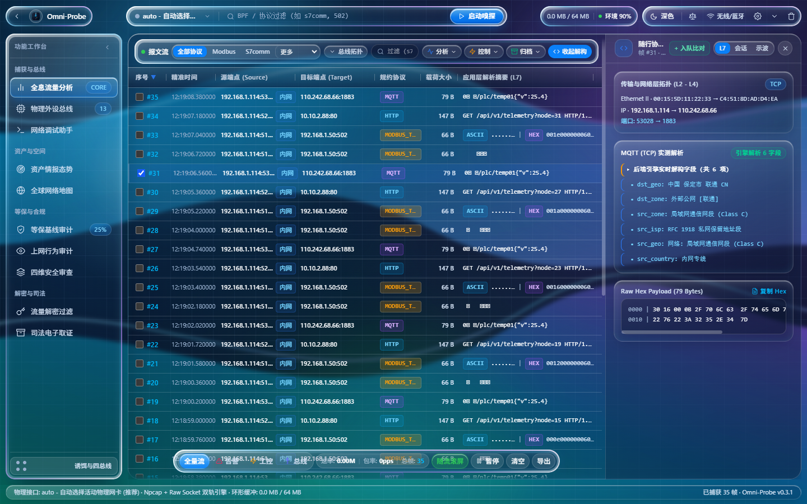

* **展开右侧随行详情**：在表格里单击任意一行，或直接按键盘 **`R`** 键 / 点击右上 **`随行解构`**，右侧会滑出逐层拆解卡片（包含传输与网络层链路、后端实时解析字段树、以及底部逐字节 `Raw Hex Payload`）。再按 **`Esc`** 或点 **`收起解构`** 关闭。
* **在某一行上点击鼠标右键**，可直接执行快捷操作：
  * **`追踪 TCP 会话流`**：把分散在不同帧里的同一次通信还原成连续上下行对话；
  * **`加入全局多组比对队列`**：把此报文收藏进天平队列，等会集中对齐找出字节差异；
  * **`推送至网络通信调试`**：直接把该目标和字节带入发包助手重发测试；
  * **`源 IP 全息档案溯源`**：查看该 IP 归属地与历史交互画像。

### 2.4 画流量速度曲线、延误统计与实时波形
点击表格右上方工具栏的 **`分析`**：

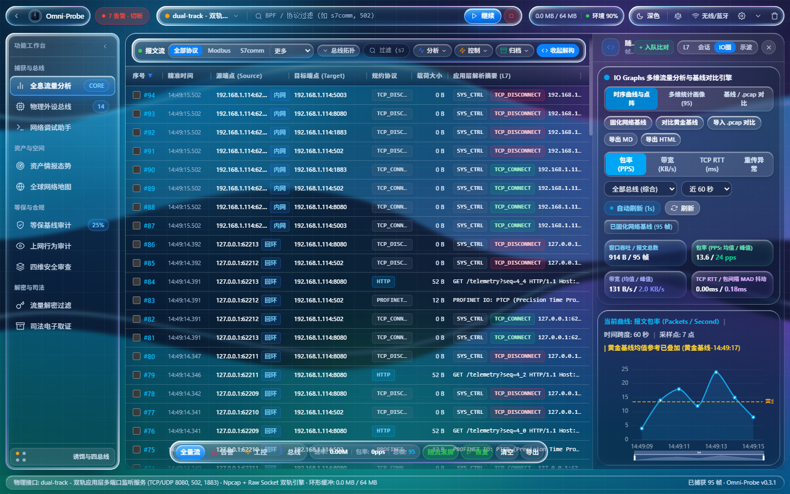

* **`IO Graphs 点阵`**：自动打开右侧 **`IO 图`** 面板，展示 4 张关键统计指标卡与基于 ECharts 的高精可缩放聚合时序曲线（支持叠加历史黄金基线均值参考虚线与重传触发散点）。面板顶部提供三大专业分析页签与工具链：
  1. **`时序曲线与点阵`**：切换监控指标（**包率 PPS**、**带宽 KB/s**、**TCP RTT ms**、**重传异常**），过滤总线来源（**全部总线** / **网卡以太网** / **COM 物理串口** / **USB 控制器总线** / **Wi-Fi / 蓝牙无线**）及时间跨度（`30 / 60 / 120 / 300 秒`），底部还能点击 **`展开点阵明细`** 查看每一秒的精准数值表。
  2. **`多维统计画像`**：对照 Wireshark 级多维流量分析视图，直接依托后端流式累加器全量实算统计（不受前端翻页数量限制，并同步兼容离线导入样本），实时呈现协议层次占比环形图、Top Talkers 活跃主机 Tx/Rx 双向吞吐排行、**RFC 2544 标准七档报文长度分布柱图**、Top 10 无向五元组会话明细表以及基于 MAD 的包间隔时间抖动（`Jitter`）：

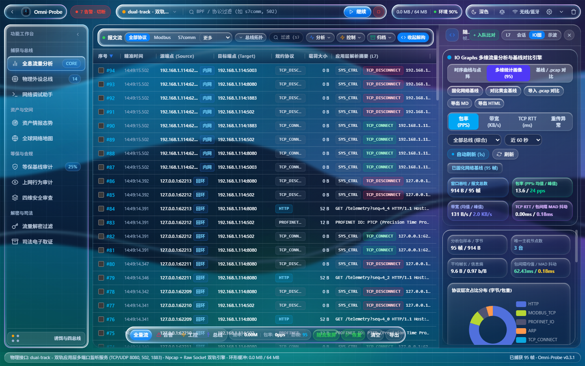

  3. **`基线 / .pcap 对比` & 报告导出**：支持一键 **`固化网络基线`**、`对比黄金基线` 或直接点击 **`导入 .pcap 对比`** 调取本地历史 `.pcap` 与当前实时流量执行协议分布、包长漂移、熵差及新增活跃 IP 对账，并可点击 **`导出 MD`** / **`导出 HTML`** 生成全转义的离线网络统计与安全审计报告。
* **`示波波形追踪`**：盯着某个目标报文载荷里第几个字节的实时高低值变化，点击 **`开始采样`** 拉出连续变化折线图。
* **`多分辨率时序与热力矩阵`**：统计两两节点交互频次与工控读写占比，支持按 `1 秒 / 10 秒 / 60 秒 / 1 小时` 粒度切换统计。

### 2.5 保存成果与导入以前的抓包文件
点击右上方工具栏 **`归档`**：
* **`导出 PCAP/CSV`**：保存为标准 `.pcap`（通用抓包软件均可打开）或 `.csv` 表格文件。
* **`导入离线 PCAP`**：在没有实时物理流量时（或分析同事发来的抓包记录），直接点此按钮或初始页面底下的 **`或导入本地 .pcap / .pcapng 离线数据包执行还原分析`**，输入文件绝对路径点 **`载入回放`** 即可一键加载进表格展开分析（支持点击 **`全局比对`** 和右侧解析）。

---

## 3. 单片机串口、波形图与硬件总线调试（`物理外设总线`）

> **进入方式**：左侧导航栏 **捕获与总线 → `物理外设总线`**

这是专门面向单片机（如 STM32、ESP32、Arduino）、PLC 串口线、USB 外设和车载电子总线的本地硬件调试与波形示波工作台。

### 3.1 连接并监控单片机 COM 串口（收发与回包测速）

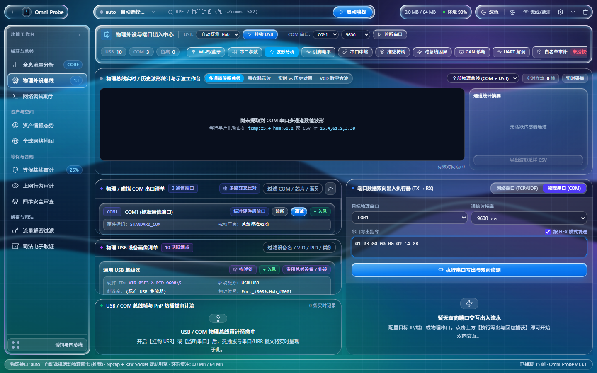

1. **选择串口与波特率**：接好串口线或 USB 转串口后，顶栏 **COM 串口** 与左下 **物理 / 虚拟 COM 串口清单** 会自动列出可用串口（例如 `COM1`、`COM3`、`COM4`，找不到可点击刷新按钮）。挑好波特率（常用 `9600` 或 `115200`）。
2. **开启持续监听**：点击该串口卡片或顶栏的 **`监听`** / **`监听串口`** 开关，下位机吐出的每行文本或十六进制报文都会进入下方审计流水。
   * 顶部工具栏还集成 **`串口参数`**（设置 Modbus 断帧间隔）、**`引脚电平`**（监控或控制 DTR / RTS / CTS 针脚）、**`串口中继`**（把实体串口转发给局域网其他软件共用），及 **`多路交叉比对`**（同时对比 2~4 个串口响应差异）。
3. **发送指令给单片机并测量回包延迟**：
   * 在右侧 **端口数据双向出入执行器 (TX → RX)** 顶部切换到 **`物理串口 (COM)`**；
   * 确认串口号和 **`通信波特率`**，如果发十六进制指令（如 `01 03 00 00 00 02 C4 0B`）需保持勾选 **`按 HEX 模式发送`**，发普通 ASCII 文字（如 `READ_TEMP\r\n`）则取消勾选；
   * 点击 **`执行串口写出与双向侦测`**；
   * 系统会在 1.2 秒窗口内自动捕获单片机传回的数据帧，并直接在下方流水条目中标出往返耗时与实收字节，点击流水条上的 **`TX↔RX 差分对比`** 立即看出发收字节差异。

### 3.2 用「波形分析」画传感器曲线、历史对照与 VCD 方波
确认顶栏 **`波形分析`** 按钮处于点亮展开状态（默认已打开），顶部右侧可按 `全部物理总线 (COM + USB)`、`仅 COM 串口`、`仅 USB 总线` 筛选来源。工作台支持以下 4 种波形模式：

1. **`多通道传感曲线`**（调单片机传感器数值最实用）：
   * 单片机串口只需像平常那样用 `printf` 打印类似 `temp:25.4 hum:61.2`、`ch0=3.30` 或逗号/空格分隔数值 `25.4,61.2,3.30`，画布会自动提取出最多 **6 条不同颜色的实时曲线**；
   * 点下方图例标签可单独显示/隐藏某一条曲线，右侧实时算好各通道 `Min` / `Max` / `Avg` 统计，点 **`导出波形采样 CSV`** 即可存成数据表。
2. **`寄存器示波`（单字段切片 / VOFA+ `JustFloat` / 自定义 Struct 多通道）**：
   * **单字段高速切片**：填好 `字节偏移`、`位宽`（1/2/4 字节）、`小端 (LE)` 与 `有符号` 或直接勾选 **`IEEE Float32`**，实时绘出单变量数值波动及 `Min / Max / Mean / Vpp`；
   * **VOFA+ `JustFloat` 多浮点**：自动识别小端浮点帧流与尾标 `00 00 80 7F`，通过 ECharts 并行绘出最多 8 条高精度传感器浮点波形；
   * **自定义 `Struct` 多通道模板**：定义可选帧头魔数（如 `AA 55`）及多字段类型 (`U8/I8/U16/I16/U32/I32/F32`)、偏移和比例因子，同时剥离多维物理量曲线并联动送入历史黄金基线比对。
3. **`VCD 数字方波`**（配合硬件逻辑分析仪与多总线解码）：
   * 导出硬件逻辑分析仪（如 Saleae / PulseView）抓到的电平信号 `.vcd` 文件（自动解析文件头的 `s / ms / us / ns / ps / fs` 时间精度刻度），点击 **`导入 .vcd 文件解码方波`** 后会自动识别文件内的通道列表，可在右侧直接切换 **`协议解调模式`**（`UART` / `I2C (双线)` / `SPI (三线)` / `CAN (位填充)`）、**`主通道 ($var)`**、**`波特率`** 及 **`奇偶校验`**（无 / 偶校验 / 奇校验）并即时重解，画面绘制真实高低电平方波图并在左下方显示 **`解码文本`**、**`HEX`**、**精度**、**跳变点数**、**总时长**、**帧错误**、**校验错**、**毛刺数** 或多总线汇总信息。
   * 如接有支持开源 **SUMP / OpenBench Logic Sniffer** 协议的物理逻辑探头（通过串口接入电脑），可点顶栏 **`UART 解调`** 展开抽屉，使用 **SUMP / OLS 物理探头直连** 进行 **`探测 SUMP 探头`** 与 **`硬件采样并转 VCD`**，随后在 **多总线 VCD 解码** 区映射 `UART / I2C / SPI / CAN` 通道完成全协议物理解调（若未接入物理逻辑分析仪串口硬件，可直接使用主串口报文分析或导入外部 `.vcd` 文件）。

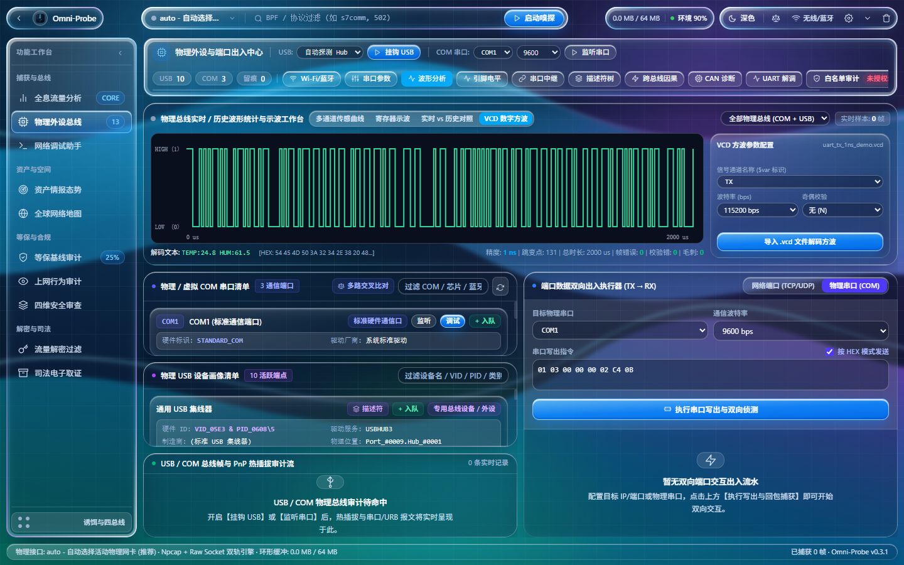

4. **`实时 vs 历史对照`（黄金波形 DTW 对齐 & FFT 频谱对比）**：
   * 想对比传感器/寄存器今天和往日标准运行曲线是否畸变，切换至 **`实时 vs 历史对照`**，可先在顶部选定目标通道并点击 **`固化黄金基线`**（生成持久化 `bus_waveform_baselines.json`），之后在任何时刻选中该基线点 **`智能对比 (DTW+FFT)`**。
   * 界面通过 ECharts 双视图实时绘出 **实时波形 vs 历史黄金波形叠加与逐点残差** 以及 **Cooley-Tukey Radix-2 FFT 功率谱密度对比（Hann 窗）**，右侧面板除量化输出 **DTW 动态时间规整形态相似度 (%)**、**Pearson 相关系数 $r$**、**均方根误差 (RMSE)** 与 **超差采样点数**外，还支持输入设定值与周期测算控制回路 **PID 阶跃响应特性**（**超调量 % / 上升时间 ms / ±2% 调节时间 / 稳态误差**）；未选黄金基线时也可点右上方 **`读取 JSONL 历史归档`** 对比历史吞吐速率、包长与信息熵：

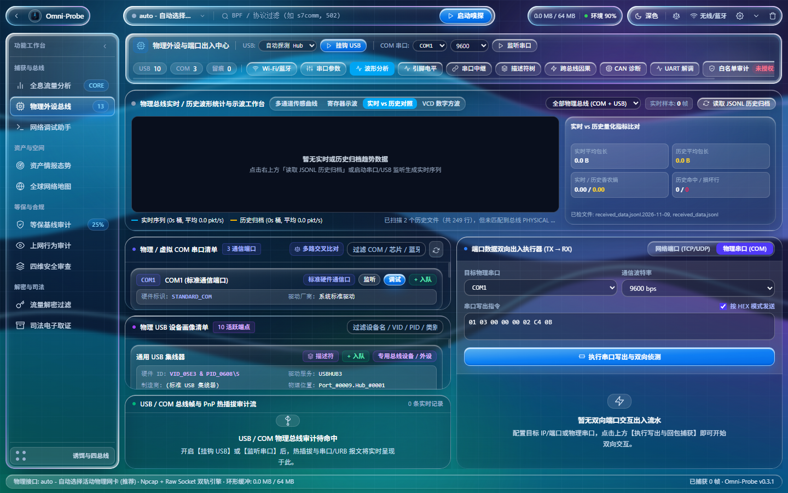

### 3.3 USB 外设监测、描述符与 COM/USB「辅助开发与报告」工作台
1. **选定集线器并抓包**：在顶部 `USB:` 下拉选中外接硬件所在的集线器（或保持 `自动探测 Hub`），点击 **`挂钩 USB`**（即便是免 `USBPcap` 的原生 PnP 模式，物理热插拔接入/拔出记录也会自动落盘写入全局存证档案）。
2. **伪装输入防护**：如果发现某 USB 设备突然以极高速度模拟键盘打字注入指令，系统会自动标红发出安全告警。
3. **查看四级硬件描述符树（免 `USBPcap` 原生直读）**：在左下角 **物理 USB 设备画像清单**（如图中已枚举 `10 活跃端点`）找到对应设备，点击 **`描述符`**：
   * 即使尚未安装 `USBPcap`，程序也会直接通过 Windows 原生 Win32 USB Root Hub IOCTL 驱动通道实时拉取该在线设备的 18 字节设备描述符与完整配置描述符，直接绘出四级硬件描述符树（设备/配置/接口/端点）；
   * 若需要抓包期间的实时 USB 控制/中断传输数据包（URB）流，仍需配合已安装的 `USBPcap` 在管理员模式下点 **`挂钩 USB`**。
4. **打开 `辅助开发与报告` 科研开发控制台**（串口发送台支持最高 `2000000 bps` 高速波特率及可持久化 **`快捷指令宏`**）：点击顶部 **`辅助开发与报告`** 展开四大专用工坊：
   * **COM 辅助开发 / Modbus 矩阵**：内置 `Modbus CRC-16`、`CCITT CRC-16`、`LRC`、`SUM-8`、`XOR-8` 校验计算器（可一键填入发包框或开启设定间隔的 **周期定时发射**）；提供 **Modbus RTU 实时寄存器快照矩阵**（自动结合先序请求基址解码显示寄存器数值变化趋势 `UP/DOWN`）；配置 **串口从站交互式自动应答规则**（按前缀/精确/Modbus 功能码匹配，自动附带 CRC16 并延时应答）；旁侧以 ECharts 展示串口帧间静默时隙 ($\Delta t$) 分布直方图与 CRC 误码统计；
   * **单片机开发伴侣 (终端/烧录/速算)**：内置 **RTOS 行式终端**（自动剥离 ANSI `[0;32m` 颜色控制符、高亮捕获 `HardFault / Guru Meditation / Watchdog / Reboot` 异常并支持导出 `.txt` / `.hex` 日志）；提供 **`.bin` 固件分片下发器**（自动计算 IEEE CRC32，可控分片长度与分片间隔）；内置 **MCU 硬件参数速算工具箱**（Timer/PWM 最优 `(PSC, ARR)` 求解、UART ±2% 时钟容限核算、Modbus/Sensor 32-bit 四端序互转与 `Bit7..Bit0` 状态灯）；
   * **USB 逆向与端点画像**：解码 8 字节 `USB Control Setup` 枚举请求及 `CDC-ACM (SET_LINE_CODING 波特率/位宽 / SET_CONTROL_LINE_STATE DTR/RTS)` 等控制帧；展示 **ECharts USB 传输类型占比环形图**与 **Endpoint 读写带宽柱状图**，并支持一键 **`导出 USBPcap (.pcap)`** 与 **`导入 .pcap 重放`**（Wireshark 标准 DLT=249）；
   * **巡检报告工坊**：汇集 COM/USB 资产、帧间间隙、Modbus 寄存器快照、USB 端点统计与黄金波形比对结果，点击 **`生成综合分析报告`** 后一键原子导出 **`.md`** 或自包含 **`.html`** 报告文件。

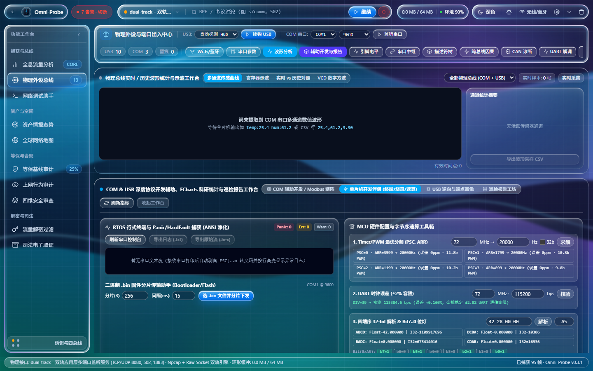

### 3.4 CAN 总线诊断与跨网关故障排查
* 点击顶部 **`CAN 诊断`**：查看 CAN / CAN-FD 总线负载率及错误帧分类；
* 点击顶部 **`跨总线因果`**：当“网口给工业网关发了请求，但接在背后的串口/CAN 传感器没反应或响应超时”时，直观定位究竟卡在网口发包、网关转换还是从站未应答。

---

## 4. Wi-Fi 频谱与蓝牙近场扫描（`无线/蓝牙`）

> **进入方式**：点击主窗口右上角的 **`无线/蓝牙`** 按钮，或在硬件工作台点击 **`Wi-Fi/蓝牙`**

打开弹窗后系统立即启动本机原生适配器检查与空口探测，包含顶部 4 个功能页签：

### 4.1 Wi-Fi 热点信号与信道分析（第 1 页签：`Wi-Fi 频谱与 AP 资产`）

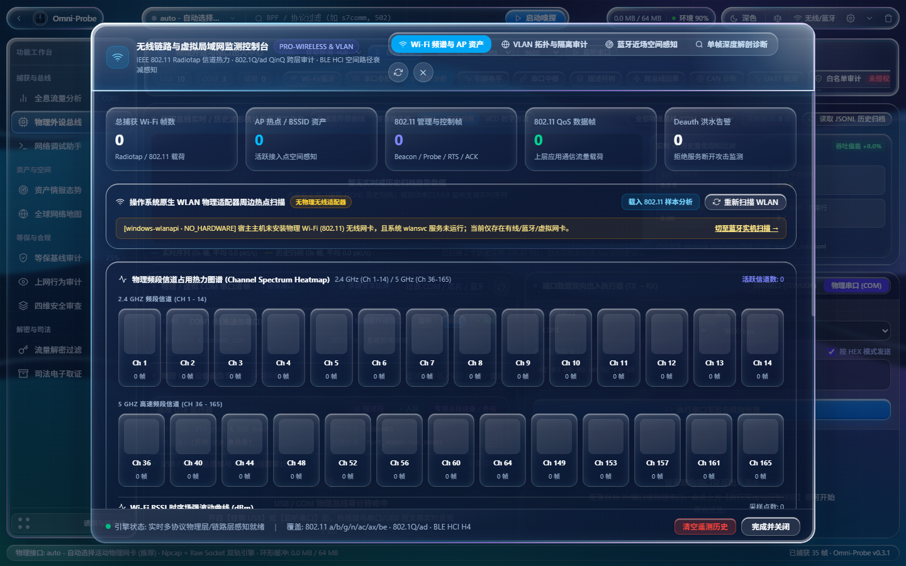

* **实机热点与信道热力图（含 IE 深度合规解析）**：如果主机配有无线网卡，上方会自动列出附近扫描到的所有 Wi-Fi 名称（SSID）、MAC（BSSID）、工作频段与 Wi-Fi 制式代际（Wi-Fi 4/5/6/7）、信道、真实加密套件/AKM、**802.11w PMF (防 Deauth 解除认证) 保护状态**、QBSS 空口负载与关联终端数及实测信号强弱（dBm），并自动绘制下方 **2.4 GHz (Ch 1–14) / 5 GHz (Ch 36–165) 物理频段信道占用热力图谱** 及 RSSI 场强波动曲线（注：受 Windows WlanAPI 原生系统边界限制，Windows 平台扫描不提供通用原始 802.11 空口帧注入能力，原始 Radiotap 帧解析可在第 4 页签或导入离线捕获包使用）。
* **无无线网卡时的友好指引**：如果你的设备是有线台式机或停用了系统 WLAN 服务，状态条会诚实给出清晰诊断与快捷入口按钮：点 **`重新扫描 WLAN`**、一键点 **`切至蓝牙实机扫描 →`** 直奔蓝牙页，或点 **`载入 802.11 样本分析`** 跳入单帧解剖台测试无线帧解码。

### 4.2 蓝牙设备探测与双模扫描（第 2 页签：`蓝牙近场空间感知`）

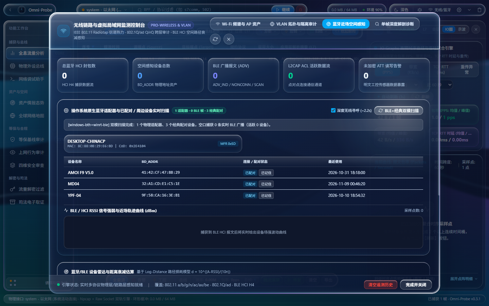

* **控制器与配对清单 + 持续流式 BLE 5.0 探测**：打开第 2 页签自动识别本机蓝牙适配器，列出系统已配对设备。点击 **`开启实时空口监听`** 可启动常驻后台 WinRT BLE 5.0 Watcher（无需管理员特权即可每秒实时采集扩展广播、`DataSections` 原始 TLV 载荷、真实 `TxPower` 与 `LE 1M/2M/Coded` 物理模式），并在雷达表中实时计算每台设备的 **广播周期 (ms)**、**包率 (pps)**、**Min/Max RSSI 区间**、**滑窗 RSSI 标准差 ($\sigma$) 与链路稳定度评分 (%)**。
* **SIG 厂商指纹 / Beacon 解析与 `BTHPORT` 驱动级 HCI 抓包**：系统内建 Bluetooth SIG 厂商 ID 映射（Apple / Microsoft / Google / Xiaomi / Nordic / Espressif 等）与 Beacon 解析器（iBeacon Major/Minor、Eddystone UID/URL/TLM 电池电压与温度、Apple FindMy/AirPods、Microsoft SwiftPair），同时检测 `SUSPICIOUS_FAST_ADV_FLOOD` 极速广播泛洪、`STATIC_MAC_TRACKABLE` 及 `SMP_JUST_WORKS_NO_MITM` 弱配对风险；以管理员身份运行时可进一步点击 **`BTHPORT HCI 抓包`**，免 `USBPcap` 直接通过 Windows 内置 `Microsoft-Windows-BTH-BTHPORT` ETW 抓捕双向 HCI Command / Event / L2CAP-ATT / SMP 原始帧（非特权启动将诚实提示权限限制而不会崩溃）。
* **历史持久化基线保存 & 实时 vs 历史差异审计**：实时捕获流自动以节流保护方式归档到数据目录 `bluetooth_history.jsonl` 及全局存证库；现场运维人员可在基准态点击工具条的 **`保存资产基线`** 生成 `bluetooth_baseline.json`，随后点击 **`实时 vs 历史对照`** 自动核查：**新增陌生蓝牙资产**、**基线失联离线资产**、**场强/测距显著漂移** 及实时均值 vs 历史均值的双线分桶差异。
* **四联 ECharts 多维射频科研图形面板**：
  1. **极坐标近场空间分布图**：依据物理 Log-Distance 模型展示周边蓝牙资产估距分布（注：径向测距为真实物理信号衰减模型推导，极角由设备 MAC 确定性哈希映射，普通单天线 PC 适配器无真实物理 AoA 到达角硬件数据）；
  2. **实时流 vs 历史基线双线趋势图**：大盘状态下对比实时与历史分桶 RSSI 均值曲线；单击列表中任意设备行后可锁定展示该单设备精细 RSSI 变化轨迹与历史基线参考线；
  3. **广播周期分布直方图 & 链路稳态汇总**：直观区分 `<35ms` 异常高速泛洪、`35~120ms` 高响应、`120~500ms` 标准外设及长周期休眠 Beacon，同时统计全场最大抖动设备 ($\sigma_{\text{RSSI}}$)；
  4. **协议分层 / SIG 厂商生态环形图**：一键在真实 HCI/L2CAP/ADV 协议层占比与 Bluetooth SIG 厂商设备分布间切换（注：Windows 通用集成蓝牙硬件不向操作系统暴露底层 Ch37/38/39 广播跳频物理通道号，需专用 Nordic nRF Sniffer / Ubertooth RF 硬件方可获取，系统绝不伪造该类通道图）。
* **`BTSnoop (RFC 1761)` 行业标准互操作 & 点对点会话字典重建**：点击 **`导出 .btsnoop`** 可把内存中原始帧按标准 Datalink 1002 (HCI UART H4) 导出，直接用 Wireshark 或 Ellisys 打开；点击 **`导入 .btsnoop 重放`** 可选择 Android `btsnoop_hci.log` 或 Wireshark 抓包离线重演全套图表；遇到真实点对点连接流量时，下方 **`HCI / L2CAP / ATT / SMP 点对点会话状态重建`** 卡片将自动追踪 `ConnHandle`、协商 `ATT MTU`、加解密状态 (`EncryptionChange`) 及 `Handle → UUID` 映射字典。
* **单设备精准近场寻距、AD TLV 透视与 GATT 逐项实时读值**：勾选右上 **`深度无线寻呼 (~2.2s)`** 后点击 **`BLE+经典双模扫描`** 可执行双模寻呼扫描；点击 **`透视`** 展开设备完整 `AD Structure TLV` 字节段并支持跳入 **`单帧深度解剖诊断`**；点击 **`GATT 审计`** 枚举服务树及检测 **`UNAUTHENTICATED_WRITE_CAPABLE`** 明文可写隐患，且可对每个标记 `Read` 属性的特征直接点击 **`实时读值`**（WinRT Uncached 直读设备寄存器实时状态）。

### 4.3 VLAN 标签监控与单帧手拆（第 3、4 页签）
* **第 3 页签 `VLAN 拓扑与隔离审计`**：检查网络流量中含有的虚拟局域网 (802.1Q / QinQ) VLAN ID、802.1p CoS 业务优先级分布（PCP 0~7）并拦截异常跨 VLAN 跳跃告警：

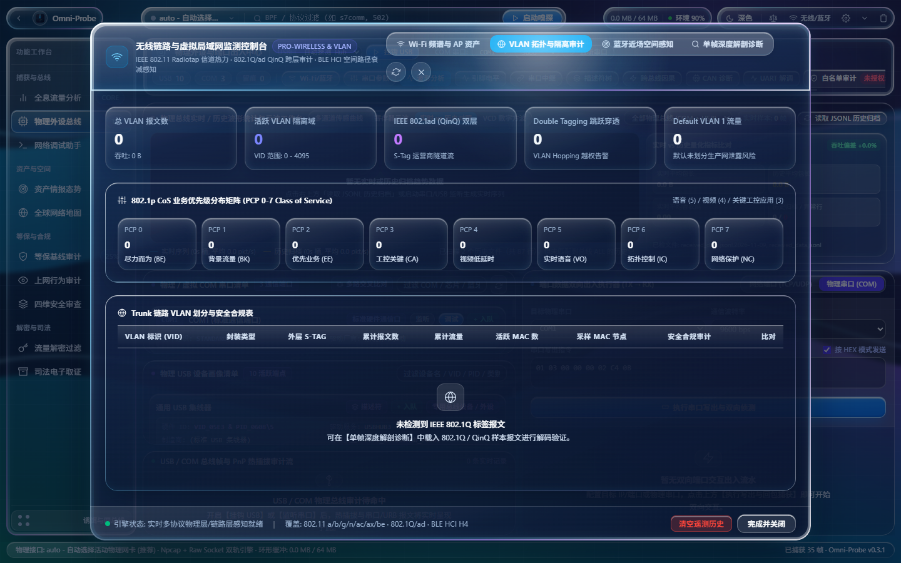

* **第 4 页签 `单帧深度解剖诊断`**：把收到的任意一段无线 802.11、VLAN 或蓝牙原始十六进制报文粘贴进去（或直接点右上方 **`Wi-Fi Beacon`** / **`QinQ Double Tagging`** / **`BLE Advertising`** 按钮加载测试样本），点击 **`执行深度原生解剖`**，下方立即列出结构化协议详情树，且可一键 **`+ 加入多组比对队列`**：

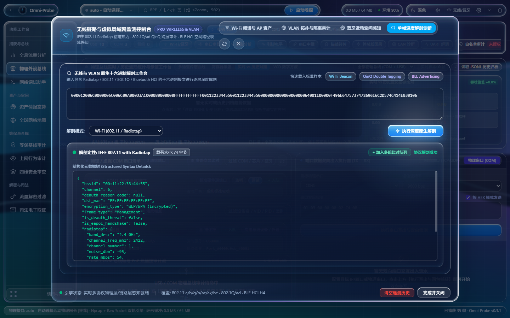

---

## 5. 网络发包调试与全网设备扫描

### 5.1 网络调试助手（左侧导航 `捕获与总线 → 网络调试助手`）

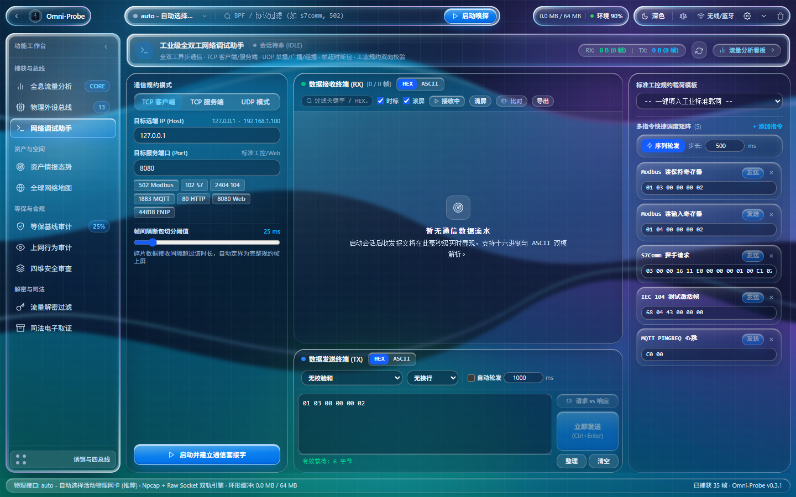

排查设备通断或测试自研服务端接口时直接当工具用：
1. 在左侧 **通信规约模式** 选好 **`TCP 客户端`**、**`TCP 服务端`** 或 **`UDP 模式`**，填写目标 IP（或快捷选择 `502 Modbus` / `102 S7` / `2404 104` / `1883 MQTT` / `80 HTTP` 等常用端口）和帧间隔分包阈值后，点击 **`启动并建立通信套接字`**。
2. 在中间下方 **数据发送终端 (TX)** 输入字符串或切换到 `HEX` 模式（可直接在下拉菜单选自动附加 CRC16/CRC32 校验和、选换行符或设自动轮发周期），点 **`立即发送 (Ctrl+Enter)`**（右侧还预设了标准多指令快捷矩阵）。
3. 在中间上方 **数据接收终端 (RX)** 实时查看回复流水；需要核对收发差了哪几个字节，点旁边 **`请求 vs 响应`** 或 **`比对`** 一键对照。

### 5.2 资产情报态势与全球网络地图

* **`资产情报态势`**（左侧 **资产与空间 → `资产情报态势`**）：

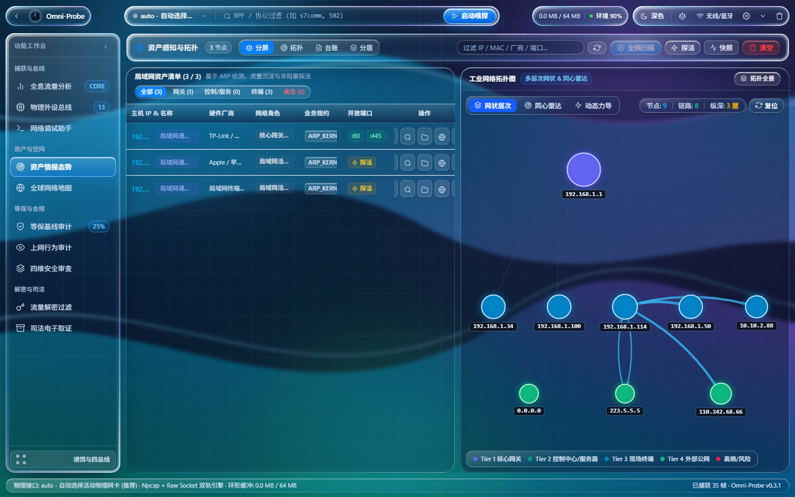

  进入后点击右上 **`全网扫描`** 自动探测当前局域网在线节点，点击 **`探活`** 可对已知资产发起覆盖 38 个 IT/OT/数据库高价值端口的批量探测，或点击右上 **`CIDR/Banner 扫描`**（及全息流量分析页顶栏 **`控制 → 靶向主动反探`**）打开 **主动探测与网段 Banner 扫描引擎**：支持输入单 IP、CIDR 网段（如 `192.168.1.0/24`，单次限流上限 512 主机与 2048 探测组合防阻塞）及端口区间/行业模板（**Top25** / **工控协议** / **数据库/高危**），通过信号量并发控制执行跨平台全连接 `TCP Connect` + 安全只读 Banner 识别 + 可选标准协议载荷触发式 `UDP` 探测（`DNS 53` / `NTP 123` / `SNMP 161` / `BACnet 47808`，仅在收到协议合法应答包时才标记 `OPEN`），提取 SSH/FTP/HTTP Server 响应或未授权 Redis `PING` / SNMP `public` 暴露提示，并在面板内绘制开放端口 RTT 响应分布图且自动回写资产雷达台账（注：不含无权底层原始 `TCP SYN` 半开包伪造及对未知 UDP 端口的无根据盲判）；上方 **`分屏`** / **`拓扑`** / **`台账`** / **`分层`** 四个按钮支持随时切换单双栏与多层级关联图，右侧直观展现 **核心网关 → 现场终端 → 外部公网** 四层连线，点击 **`快照`** 还可留存基线对比网络资产变迁：

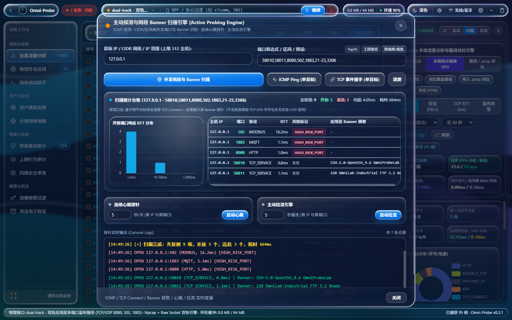

* **`全球网络地图`**（左侧 **资产与空间 → `全球网络地图`**）：

  当你启动嗅探上网或导入外网抓包后，支持 **`3D 地球`** 与 **`2D 全景`** 双视图连线呈现通信对端地理城市，点击右侧 **`通讯 IP 清单`** 里的任意公网地址或选择上方 **`路由中转追踪`**，即可查看每跳路由经过的城市节点与往返流量统计。

---

## 6. 安全审计、流量解密与取证导出

### 6.1 等保基线与安全审查三板块

* **`等保基线审计`**（左侧 **等保与合规 → `等保基线审计`**）：

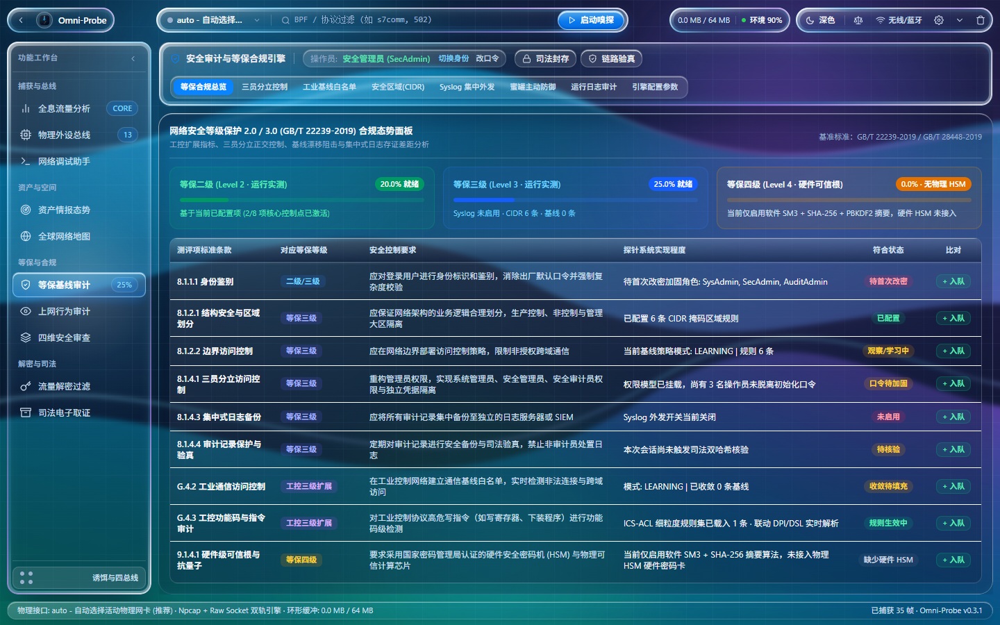

  页面内建 8 个合规控制页签：**`等保合规总览`**（对照 GB/T 22239 逐条打分评估）、**`三员分立控制`**（管理系统管理员/安全管理员/审计员账户与改密）、**`工业基线白名单`**（把确认合法的 USB/串口加入白名单，阻止陌生 U 盘接入）、**`安全区域(CIDR)`**、**`Syslog 集中外发`**、**`蜜罐主动防御`**（开启高仿真工控诱饵服务留存扫描者指纹）、**`运行日志审计`** 及 **`引擎配置参数`**（可直接在页面上维护监听端口表并保存，不用手动找配置文件）。

* **`上网行为审计`** & **`四维安全审查`**：自动整理电脑历史访问的网址域名、文件还原记录，并识别外发流量中明文夹带的身份证号、银行卡号、自定义秘密字样及违规外传记录。

### 6.2 解密 HTTPS / HTTP3 加密流（`流量解密过滤`）

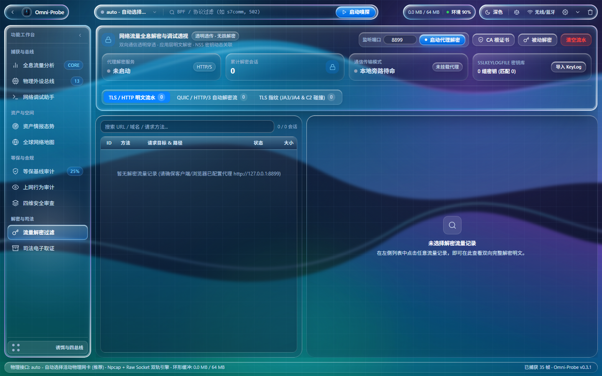

看到满屏加密的 TLS 流量看不清接口内容？在这里提供两条排查路径：
* **有密钥日志文件时**：点右上方 **`导入 KeyLog`** 载入浏览器或系统导出的 `SSLKEYLOGFILE` 密钥文件，结合 **`被动解密`** 直接把抓包流里的 TLS 1.2 / 1.3 加密 HTTP 请求还原为明文。
* **本地直连调试时**：在顶栏填好端口（默认 `8899`），点击 **`启动代理解密`** 并在客户端配置代理到 `127.0.0.1:8899`，点击 **`CA 根证书`** 按提示信任证书后即可明文透视请求体；切换到下方 **`QUIC / HTTP/3 自动解密流`** 或 **`TLS 指纹 (JA3/JA4 & C2 碰撞)`** 还可核查现代 QUIC 握手帧与客户端异常 TLS 指纹。

### 6.3 导出权威电子取证文档（`司法电子取证`）

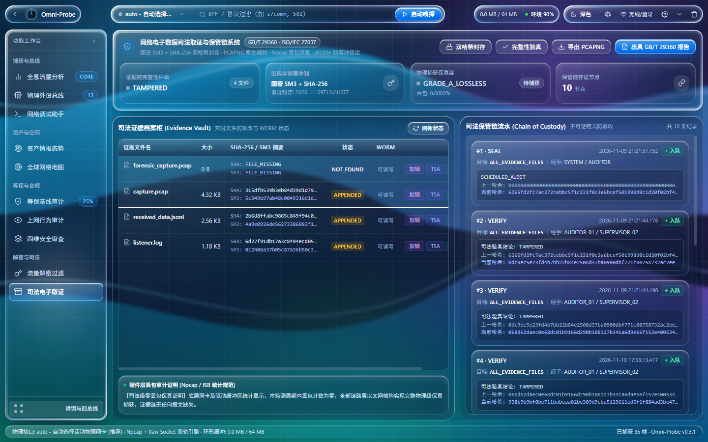

当现场排查到的抓包数据需要作为严肃故障凭证或审计档案长期留存时：
1. 进入左侧 **`司法电子取证`**，正常运行时系统每隔 60 秒会自动给抓包文件与日志计算国密 SM3 + SHA-256 防篡改摘要封存。
2. 当要人工立刻固化当前现场，点右上角 **`双哈希封存`**；以后可随时点击 **`完整性验真`** 校验保管链有没有发生任何意外截断或改动；下方表格对应行点击 **`加锁`** 可启用防覆盖锁定（只读保护）。
3. 点击 **`导出 PCAPNG`**（标准带统计块的升级抓包文件）或 **`出具 GB/T 29360 报告`**，一键生成合规检验报告归档。

---

## 7. 报文与文件差异对比中心

> **任意界面快捷唤出**：按 **`Ctrl + Shift + D`**，或点右上角顶部工具条的 **天平图标**

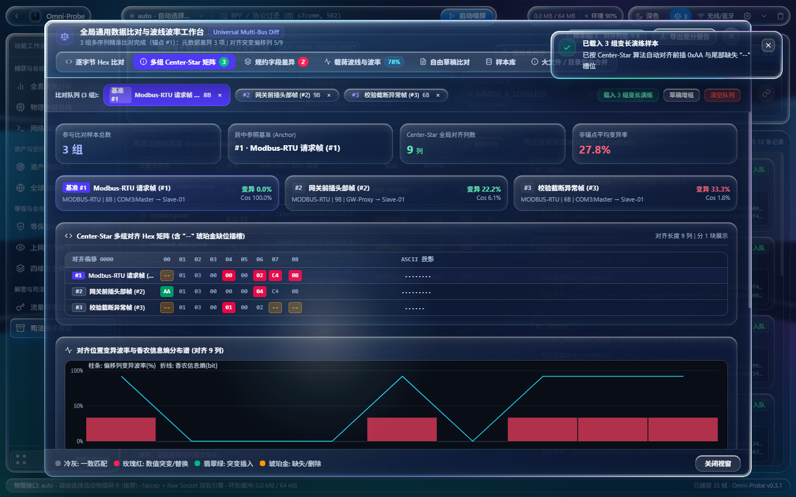

无论你是要比两条报文、3~10 条串口/Modbus 回包，还是直接比对两个几十 MB 的源码/固件目录，都集中在这里处理：
1. **双样本精确对齐（`逐字节 Hex 比对`、`规约字段差异`、`载荷波线与波率`）**：在抓包流、调试台、串口清单位点 **`+ 入队`** 收藏两条数据后唤出本窗，工作台用三色严格标出差异字节：**冷灰**（完全一致）、**玫瑰红**（数值修改）、**翡翠绿**（额外插入）、**琥珀金**（字节缺失）。
2. **`多组 Center-Star 矩阵`（2~N 组同时比对）**：入队 3 条及以上相似但长度不等的串口或网络包（也可在窗口内直接点 **`载入 3 组变长演练`** 预览效果），自动找出中间参考基准并用琥珀金 `--` 补齐插槽对齐展示，下方同步绘制逐偏移位置的 **变异波率柱状图** 与 **香农信息熵分布曲线**。
3. **`自由草稿比对` & `样本库`**：没入队前想临时比对两段粘贴出来的十六进制或字符，切换 **`自由草稿比对`** 随时贴上即比；常用标准报文还能存进 **`样本库`** 随时复用。
4. **`大文件 / 目录双向合并`**：直接对比两个数十 MB 的工程文件或文件夹里的全量代码/二进制固件差异，支持逐块手动点选左右覆盖合并（每次改写磁盘文件前会自动留一份 `.bak` 备份防止误操作）。

---

## 8. 偏好设置与系统自动存盘规则

### 8.1 个性化调节（按 `Ctrl + ,`）

通过快捷键 `Ctrl + ,` 或点击顶栏右上角的齿轮图标打开设置中心，左侧分为 4 大板块：
* **`运行环境与自愈`**：切换启动时发现可选插件未装是否要在角落弹窗温和提醒，一键直通环境检查器。
* **`版本检查与更新`**：显示当前软件版本（如 `v0.3.2`），点击检查最新版本发布情况。
* **`视觉质感与布局`**：在 **深空夜色**（上面章节默认配色）和 **冰晶白昼**（如下方明亮高对比办公浅色主题）之间无缝切换，或控制侧边栏默认展开/紧凑状态：

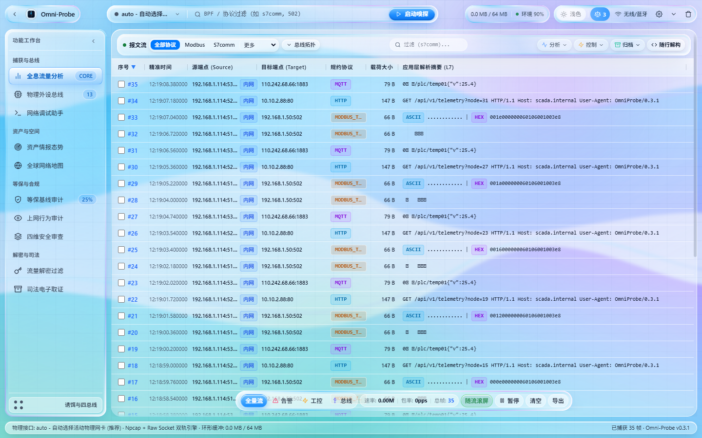

* **`存证与数据引擎`**：快速查看或清理运行缓存与历史记录。

### 8.2 数据存在哪里？会不会把硬盘撑爆？
* 所有配置文件、抓包流水与证明文件全部统一存放在本程序专属数据目录（便携启动在 `.exe` 同级相关目录，系统安装版自动存入用户 `AppData` 应用数据目录），不污染桌面或系统盘根目录：
  * **`config.json`**：你的工业监测端口表与配置项都存在这里，首次启动时若缺失会自动生成标准默认配置，也可直接在「等保基线审计 → 引擎配置参数」页面可视修改保存。
  * **`received_data.jsonl`**：跨网络、串口、USB、无线总线的按行记录流水文件。系统在跨天时会自动按日期轮转打包归档，**并且只保留最近 30 天**，超期自动删除防占满磁盘；「物理外设总线 → 实时 vs 历史对照」面板直接读取这些历史归档来做偏差走势对照。
  * **`capture.pcap`**：标准以太网抓包镜像文件。
  * **`listener.log`**：后台各采集模块与驱动状态记录日志。

---

## 9. 常见问题现场自助排查

| 遇到的问题 | 常见原因 | 推荐解决办法 |
| :--- | :--- | :--- |
| **点完「启动嗅探」后列表中半天没流量或提示权限不足** | 1. 顶部选成了当前没有流量的虚拟网卡； 2. 没有装 `Npcap` 抓包驱动且未用管理员身份启动。 | 1. 换选正在上网的有线/无线真实网卡，或切选 **`native-ndis - Windows 内置 NDIS-ETW 免驱 L2 引擎`** 并 **以管理员身份运行**（无需安装 `Npcap` 也可捕获 L2 帧）； 2. 本地测试程序发包至 `8080`/`502`/`1883` 请选 `dual-track`；非特权模式亦支持点顶部 **`环境 XX%`** 按需安装 `Npcap`。 |
| **插着单片机，选了 COM 口发数据，但回复计数一直是 0 / 超时** | 1. 忘记先点开该串口卡片上的 **`监听`**； 2. 波特率选错（下位机是 115200 界面留着 9600）； 3. 该串口同时被其他串口调试助手或烧录工具占用了； 4. 单片机回复超过了 1.2 秒。 | 1. 先关掉其他串口助手/烧录软件； 2. 在右侧 **`物理串口 (COM)`** 与左侧清单核对一致波特率并打开 **`监听`**； 3. 再点发送测试。 |
| **「多通道传感曲线」面板一直是黑屏空白，说没提炼出通道** | 串口上报内容并非标准数值格式（如 `temp:25.4 hum:61.2` 或逗号分隔数），或顶部把「物理总线范围」筛选错为 `仅 USB`。 | 1. 核对面板右上角下拉已选 `全部物理总线 (COM + USB)` 或 `仅 COM 串口`； 2. 若设备发的是纯二进制报文，直接点击切换到旁边的 **`寄存器示波`** 标签即可设偏移量画图。 |
| **点「挂钩 USB」后没有任何数据包，几秒后显示 0 帧退出** | Windows 底层读取 USB 驱动必须有管理员权限，或者顶部下拉选了未挂设备的空集线器。 | 1. 在 **`环境 XX%`** 确认已安装 `USBPcap`； 2. 使用 **以管理员身份运行** 启动本软件； 3. 顶栏 `USB:` 下拉选定对应 Hub 后点挂钩，拔插或操作外设测试。 |
| **点「无线/蓝牙」打开 Wi-Fi 页没有任何周边热点** | 1. 若提示「无物理无线适配器」，说明这台台式机本身未插无线网卡； 2. 若提示「WLAN 服务已停止」，是电脑把无线服务关了。 | 1. 台式机无无线网卡可插免驱 USB 网卡或点蓝色引导按钮 **`切至蓝牙实机扫描 →`** 做近场探测； 2. 若服务未开请在系统里启用 WLAN 服务后点 **`重新扫描 WLAN`**。 |
| **点按钮后右侧抽屉看不到图表 / 找不到小图标名称** | 屏幕分辨率较窄时部分顶部标签仅展示图标。 | 按 **`Esc`** 键可随时关闭当前浮窗；鼠标悬停在图标上 1 秒即可显示中文提示；右键表格或按 `R` 键可快速开关右侧剖析抽屉。 |
